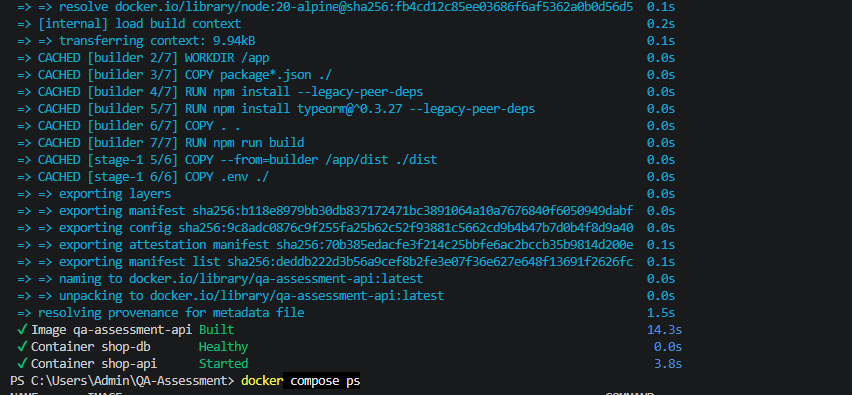

# Docker Containerization and Build Troubleshooting Report

## 1. Objective

The objective was to containerize the NestJS application and PostgreSQL database, bring up the full application stack using Docker Compose, and review the Docker configuration for reliability, security, and maintainability.

The application stack consists of:

- NestJS REST API
- PostgreSQL 16 database
- Docker Compose orchestration

## 2. Configuration Review

### Dockerfile
The original Dockerfile successfully built and started the NestJS application. However, the following improvements were identified:


| Issue | Impact | Improvement |
|---|---|---|
| `npm install` used during image builds | Dependency installation may differ between builds | Use `npm ci` with the committed lockfile |
| TypeORM installed separately | Dependency management is inconsistent | Declare TypeORM in `package.json` |
| `.env` copied into the image | Risk of exposing sensitive configuration | Inject environment variables at runtime |
| Development dependencies installed in runtime image | Larger production image | Install production dependencies only in the runtime stage |

### docker-compose.yml

The original Compose configuration correctly defined the API and PostgreSQL services.

Important configurations:

- PostgreSQL uses a persistent named volume.
- The API connects to PostgreSQL using `DB_HOST=db`.
- The API waits for the database health check before starting.
- Port 4000 is exposed for the API.
- Port 5432 is exposed for PostgreSQL.

The database health check was improved to use escaped Compose variables (`$$POSTGRES_USER` and `$$POSTGRES_DB`) so that PostgreSQL evaluates them inside the container.

### docker-compose.dev.yml

The development Compose configuration defines PostgreSQL only. This supports a development workflow where the database runs in Docker while the NestJS application runs locally.

The obsolete `version: '3.9'` declaration was removed because modern Docker Compose does not require it.

## 3. Problems Encountered and Resolutions

### Issue 1: Docker Engine was unavailable

**Problem:** Docker commands initially failed because the Docker Desktop Linux engine was not running.

**Diagnosis:** Executed:

```bash
docker info
```

The command returned an error indicating that Docker could not connect to the Docker Desktop Linux engine.

**Resolution:**

1. Opened Docker Desktop.
2. Waited for the Docker Engine to start.
3. Executed `docker info` again.
4. Confirmed that the Docker server was available.

**Result:** Resolved.

### Issue 2: Docker Compose configuration file not found

**Problem:** Running Docker Compose commands from `C:\Users\Admin` returned:

```text
no configuration file provided: not found
```

**Diagnosis:** The terminal was not opened in the project directory containing the Compose configuration.

**Resolution:**

```powershell
cd C:\Users\Admin\QA-Assessment
```

Then executed the Compose commands from the project root.

**Result:** Resolved.

### Issue 3: Dockerfile dependency and security improvements

**Problem identified during configuration review:**

- Dependencies were installed using `npm install`.
- TypeORM was installed separately inside the Docker build.
- The `.env` file was copied into the Docker image.

**Resolution:**

- Use `npm ci` for reproducible dependency installation.
- Manage TypeORM through `package.json` and `package-lock.json`.
- Remove the `.env` copy instruction.
- Provide environment variables through Docker Compose at runtime.
- Add `.dockerignore` to exclude sensitive files and unnecessary build artifacts.

**Result:** Configuration improvements identified and incorporated into the revised Dockerfile.

## 4. Container Startup Verification

Executed:

```bash
docker compose ps
```

Observed results:

| Service | Container | Status | Port |
|---|---|---|---|
| API | shop-api | Running | 4000:4000 |
| Database | shop-db | Healthy | 5432:5432 |

The application logs confirmed:

- PostgreSQL initialized successfully.
- PostgreSQL reported that the database system was ready to accept connections.
- TypeORM initialized successfully.
- NestJS modules initialized successfully.
- API routes were registered.
- NestJS reported successful application startup.

The initial PostgreSQL initialization shutdown and restart messages were part of the normal first-time initialization process, not an application failure.

## 5. Final Verification

The containers were confirmed running, and the database health check reported healthy.

The following additional checks are required to complete end-to-end verification:

```powershell
Invoke-RestMethod http://localhost:4000/
Invoke-RestMethod http://localhost:4000/users
Invoke-RestMethod http://localhost:4000/products
```

## 6. Conclusion

The NestJS API and PostgreSQL database were successfully started using Docker Compose.

The initial Docker Engine and working-directory issues were diagnosed and resolved. The container logs confirmed successful database initialization and NestJS application startup.

The Dockerfile and Compose configurations were also reviewed, with improvements identified for dependency reproducibility, environment-variable security, image size, and development workflow separation.

The final HTTP endpoint verification should be completed before declaring the full application stack fully tested.
